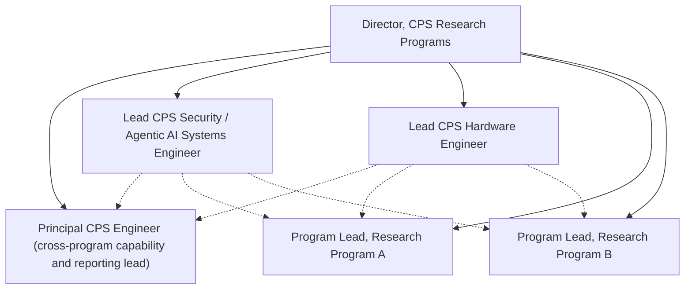

<!-- generated by aof from templates/os/ORG_CHART.md.j2; edit the config or the template, not this file -->
# Org chart: CPS Research Directorate

Status: draft
Owner: Director, CPS Research Programs

Solid lines are reporting lines (`reportsTo`). Dotted lines are support relationships (`supports`) and carry no
authority. Authority over protected effects comes only from `decisionRights`.

## Hierarchy

- **Director, CPS Research Programs** (`director`): programs program-a, program-b
  - **Principal CPS Engineer (cross-program capability and reporting lead)** (`principal-cps-engineer`): programs portfolio-integration
  - **Lead CPS Security / Agentic AI Systems Engineer** (`lead-cps-security-agentic-ai-se`): programs agentic-os-first-slice, cps-security-assurance
  - **Lead CPS Hardware Engineer** (`lead-cps-hardware-engineer`): programs cps-hardware-platforms
  - **Program Lead, Research Program A** (`program-lead-a`): programs program-a
  - **Program Lead, Research Program B** (`program-lead-b`): programs program-b

## Reporting lines

| Principal | Reports to |
|---|---|
| principal-cps-engineer | director |
| lead-cps-security-agentic-ai-se | director |
| lead-cps-hardware-engineer | director |
| program-lead-a | director |
| program-lead-b | director |

## Dotted (support) lines

| Principal | Supports |
|---|---|
| lead-cps-security-agentic-ai-se | principal-cps-engineer |
| lead-cps-security-agentic-ai-se | program-lead-a |
| lead-cps-security-agentic-ai-se | program-lead-b |
| lead-cps-hardware-engineer | principal-cps-engineer |
| lead-cps-hardware-engineer | program-lead-a |
| lead-cps-hardware-engineer | program-lead-b |

## Diagram

## Programs

| Program | Name | Owner | Stage | Data tier |
|---|---|---|---|---|
| agentic-os-first-slice | Agentic OS first slice (the OS builds itself first) | lead-cps-security-agentic-ai-se | poc | internal |
| cps-security-assurance | CPS security and agentic-AI assurance across programs | lead-cps-security-agentic-ai-se | poc | program-restricted |
| cps-hardware-platforms | CPS reference hardware platforms | lead-cps-hardware-engineer | mvp | program-restricted |
| portfolio-integration | Cross-program capability registry and reporting | principal-cps-engineer | poc | internal |
| program-a | Research Program A | program-lead-a | production | program-restricted |
| program-b | Research Program B | program-lead-b | production | export-controlled |
