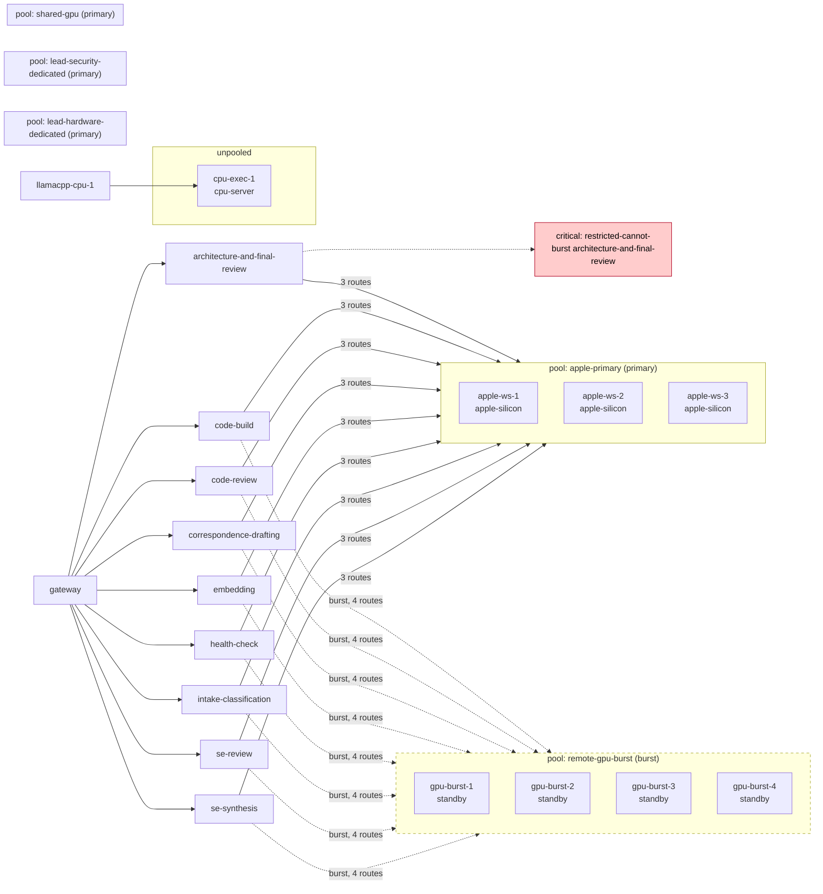

# Compute plane: deployment diagram

Generated from the configuration and the surveyed inventory (see `COMPUTE_PLANE.md`). Primary pool solid, burst pool dashed; each edge carries the number of routes from a capability class to a pool; critical gaps in red.

