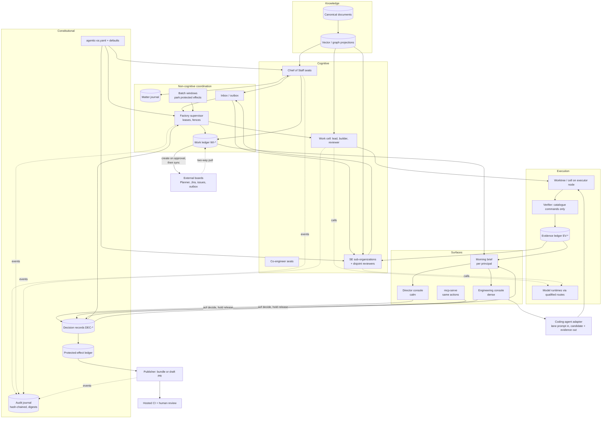

# Architecture

Status: draft
Owner: project maintainers

This document describes the Agentic OS that the templates generate: its logical planes, the
authority invariants that hold everything together, the organs and the artifacts each one owns,
how the OS is generated from configuration, how it is activated in waves, how an existing (brownfield)
agentic ecosystem is fused in, how it runs on an organization's existing host framework, how the same
design runs on a laptop or on a large GPU fleet, and how it operates day to day: the work ledger and its
board projections, the audit journal, unattended batch windows, the consoles and the coding-agent adapter.

Related: [METHODOLOGY.md](METHODOLOGY.md) (why), [OPERATING_PRINCIPLES.md](OPERATING_PRINCIPLES.md)
(rules), [GLOSSARY.md](GLOSSARY.md) (terms), [TEMPLATE_CONTEXT.md](TEMPLATE_CONTEXT.md) (render contract).

## 1. Planes

The OS is five logical planes. Technology choices inside each plane are replaceable adapters.

| Plane | Holds | Rule |
|---|---|---|
| **Constitutional** | Principals and decision rights, policy revisions, the canonical owner registry, principal decisions, the protected-effect ledger, work and evidence lineage, the audit journal | Changes only through a recorded human decision or a reviewed config change |
| **Non-cognitive coordination** | Durable workflow state, the work ledger and its board sync, inbox/outbox, leases, fences, event ordering, backpressure, batch windows, read models | Validates transitions; makes no domain judgment. **No model is ever the coordinator or the ledger.** |
| **Cognitive** | Chief of Staff seats, co-engineer seats, SE sub-organizations and reviewers, factory leads, builders and reviewers | Models *propose*. Trusted harness code applies, commits, runs commands and records evidence |
| **Knowledge** | Canonical documents, retrieval projections, provenance, context compilation | Vector and graph indexes are projections of canonical documents, never the source of truth |
| **Execution** | Worktrees, host cells, model runtimes, verification commands, evidence collection | Runs only what a lease and a verification catalogue allow |

## 2. Authority invariants

Each invariant is logically singular even when storage is replicated. A design change that would
create a second one of any of these is rejected.

| Invariant | Meaning | What it prevents |
|---|---|---|
| One owner per artifact kind | Every artifact kind (intake, SE pack, RTM, candidate, briefing) has exactly one registered owning organ | Two organs writing the "same" truth and diverging |
| One accepted authority epoch | Policy and decision rights are evaluated against one current epoch; work carries the epoch it was approved under | Approvals granted under old policy being used under new policy |
| One accepted work-program revision | Revisions are monotonic: a new revision is the last accepted one plus one | A revised package being refused as stale, or two packages both "current" |
| One winning attempt fence | When a work cell dies mid-task, the old attempt is fenced and only the successor's higher fence is admitted | Two attempts both delivering a candidate for the same item |
| One accepted evidence fact per identity | A given claim about a given revision has one accepted record | Cherry-picking the green run out of several |
| One protected-effect state per exact target | `merge` of a given head to a given branch has one state: draft, awaiting approval, approved, dispatched, confirmed, failed or cancelled | Replays and double sends |

Deny-by-default: every protected effect (`governance.protectedEffects`) is denied unless a principal
holding that decision right has recorded a decision for the exact target. No effect is inferred from
a UI action, model output or silence ([ADR-0002](adr/ADR-0002-authority-separation-and-deny-by-default.md)).

## 3. Organs and their canonical artifacts

| Organ | Rendered under | Seats | Owns (canonical artifacts) | Forbidden |
|---|---|---|---|---|
| **Chief of Staff ecosystem** (per principal) | `os/principals/<id>/chief-of-staff/` | intake-provenance, context-knowledge, portfolio-dependencies, delegation-receipts, decision-briefing, continuity-resumption, resource-cost-attention, exception-escalation, plus optional status-rollup, correspondence-drafting, calendar-attention, handoff-choreography | Intake records, matter state, decision briefings, final briefings, status rollups | approve-as-principal, impersonate-domain-principal, self-verify-coordinated-work, widen-delegation, merge, deploy, send-external-correspondence, purchase, mutate-infrastructure, mutate-production |
| **Co-engineer ecosystem** (per principal) | `os/principals/<id>/co-engineer/` | By discipline (`organs.coEngineers.seatsByDiscipline`), e.g. requirements-analyst, code-partner, hazard-analyst, schematic-reviewer, tech-writer | The principal's working drafts; promoted into an organ only through intake | Exercising the principal's decision rights; reading another principal's notes unless `sharedKnowledgeAcrossPrincipals` |
| **Systems Engineering organization** | `os/systems-engineering/`, `os/programs/<id>/` | Per sub-organization: intake, domain-lead, artifact-custodian, independent-reviewer (+ optional artifact specialists) | Needs, requirements, RTM, architecture and trades, interfaces, hazards, VCRM, baselines, adjudications | Building what it adjudicates; allocating reviewers by list position |
| **Factories** | `os/factories/<id>/` | Supervisor (non-cognitive) + work cells of lead, builder, reviewer, verifier | Leases, candidate commits or artifacts, factory evidence records | Push (`executorMayPush: false`), merge, editing its own oracle, self-review |
| **Correspondence** | `os/correspondence/` | Drafting and coherence seats | Drafts and hold records with reasons | Sending without the principal (`external-send`) |
| **Workflows** | `os/workflows/<id>/` | Steps executed by named seats | Workflow instances and their returns | Any protected step without `requiresApprovalFrom` |
| **Governance** | `os/governance/` | Owners of the kill switch and escalation chain | Decision rights matrix, protected-effect register, merge gate | n/a |
| **Knowledge** | `os/knowledge/` | Custodians per store | Store register with owner, tier and projection flag | Treating a projection as truth |
| Optional: hardware engineering, security engineering | same pattern | SE seats with hardware or assurance custody | BOMs, ICDs, threat models, agent tool allowlists | Same as SE |

Work-cell independence: builder and reviewer come from different actors; the verifier is not
correlated with lead, builder or reviewer; a reviewer route must not share provider, model and host
with the work it reviews, and must be capable enough for the concern it reviews.

## 4. Configuration is source; generation is the build

- `agentic-os.yaml` is the only hand-edited source. `config/defaults.yaml` and
  `config/kinds/<kind>.yaml` are merged under it (later wins, lists replace).
- The merged config is validated against `schema/agentic-os.schema.json`; the inventory against
  `schema/inventory.schema.json`.
- `aof render` produces `os/` plus `MANIFEST.yaml` (each file, its template, its sha256).
  `aof plan` shows the path-level diff before you overwrite anything.
- **Never hand-edit output.** A hand edit is lost on the next render and is invisible to review.
  Change the config, or change the template upstream, and render again.
- **Customer-private content goes in an overlay**: the customer's own repository holds their
  `agentic-os.yaml`, `inventory.yaml`, any private templates and their rendered `os/`. The template
  repository never holds customer content. See [ADR-0001](adr/ADR-0001-configuration-as-source.md).
- The render is deterministic for a given config, inventory and template revision, so two renders
  can be compared by manifest digest.

### 4.1 Activation status

Configuration describes the whole intended OS; `rollout` decides how much of it is live. Every principal,
seat, SE sub-organization, factory, workflow, integration and knowledge store has an **activation
status** derived from `rollout.currentWave` and the waves that activate it: `active` (its wave is at or
below the current wave), `planned` (a later wave activates it), `unscheduled` (configured but in no wave)
or `all-active` (no waves defined; acceptable only for a solo setup). Rendered per-item files state it on
an `Activation:` line, and `aof render --only-active` omits planned and unscheduled items entirely. A
planned seat's charter is readable but must not be run
([ADR-0009](adr/ADR-0009-incremental-activation-one-ecosystem-first.md)).

## 5. Brownfield fusion

Most organizations already run agentic tools: a coding assistant, a review bot, an internal RAG
service, an automation platform, a home-grown multi-agent framework. Fusion happens *before*
building anything new ([ADR-0007](adr/ADR-0007-brownfield-fusion-before-build.md)).

1. **Inventory.** `aof survey` finds model servers, MCP servers, A2A agents (`/.well-known/agent-card.json`
   first, per A2A 1.0; the legacy `/.well-known/agent.json` only as a fallback, and the inventory records
   which answered), desktop assistant configs and repositories. The interview adds what the survey cannot see.
2. **Describe.** Each solution becomes an `existingSolutions[]` entry: kind, owner, users, its own
   tier vocabulary verbatim, interfaces, capabilities, strengths, gaps, data tier.
3. **Map.** `mapsTo` names the organ, seat or factory it would fill.
4. **Decide.** One of `adopt` (use as-is as a seat or organ), `wrap` (expose through an MCP or A2A
   adapter so the OS can route to it), `replace` (the template organ supersedes it), `retire`,
   `build-alongside` (run both during transition), or `undecided`.
5. **Prove.** Capability claims are backed by an `evidenceRef`. A claim without evidence is
   `read-only-inspection` at best.
6. **Improve.** `improvementPlan` records what the solution needs to meet the organ's contract
   (for example "emit evidence bound to revision", "accept a verification catalogue").

Fused solutions are referenced from `principals[].coEngineer.sourcedFrom` and
`organs.factories.factories[].sourcedFrom`, so the rendered charters say which seat is backed by an
existing tool. The organ contract does not change because the implementation is borrowed.

## 6. Runs on the host framework

Some organizations already operate a dynamically scalable agent or engineering baseframework: something
that spawns agents, delegates to sub-agents, registers tools, scales workers and keeps tiers. When one
exists, the OS is implemented **on** it, not beside it ([ADR-0010](adr/ADR-0010-run-on-the-host-framework.md)).

`rollout.hostFramework` names it (`existingSolutionId`, an `existingSolutions[]` entry), states the
`integrationMode` (`adopt`, `wrap` or `build-alongside`) and rates each capability the OS needs:

| Capability | If `mature` | If `partial` | If `absent` |
|---|---|---|---|
| dynamic-scaling, agent-spawning, sub-agent-delegation, scheduling | Seats and work cells are spawned and scaled by the host; the template supplies role contracts and leases only | Host spawns; template adds leases, fences and the attempt journal the host lacks | Template supervisor and work-cell plumbing |
| tool-registry | Seat tool allowlists map onto host tool ids | Allowlists enforced by template wrapper around host tools | Template allowlists |
| tiering | Host tiers mapped to data tiers and model classes, verbatim names kept | Mapping plus template checks for gaps | Template data boundary |
| model-routing | Host router used; template supplies capability classes and qualification policy | Host router plus template qualification and quarantine | Template routing policy over the inventory |
| data-boundary | Host enforcement used; template verifies with a smoke check | Template enforcement in front of host calls | Template enforcement |
| evidence-ledger, observability | Host records mapped to `schema/evidence.schema.json` fields | Template ledger fed from host logs | Template ledger |
| protected-effects | Host approval mechanism used if it is deny-by-default and exact-target | Template gate in front of host effects | Template gate |
| independent-review, verification-harness | Host reviewers and runners used if independence groups can be expressed | Template adds independence binding and verification catalogue | Template reviewer and verifier seats |
| knowledge | Host stores registered in `knowledge.stores` with owner and projection flag | Template provenance and synthetic marking added | Template knowledge stores |

Rules:

- **Never a second scheduler beside a working one.** Two schedulers mean two sources of truth for
  leases and two places a task can be lost.
- The template's contracts (forbidden authorities, independence, evidence binding, deny-by-default) do
  not weaken because the host implements them; a smoke check in wave 0 proves each mapped capability.
- Host vocabulary is kept verbatim in its own docs; the mapping lives in `rollout.hostFramework.notes`
  and in the rendered `os/ecosystem/` files.
- Raising a capability from `partial` to `mature` is a config change after the host gains it, with
  evidence; the template plumbing for it is then retired.

## 7. Scaling from a laptop to an abundant GPU fleet

The organs and invariants are identical at every size. What changes is the routing and the number of
parallel cells, driven by `resources.posture` and the inventory.

| Posture | Typical resources | Routing defaults | Cells |
|---|---|---|---|
| `constrained` | One laptop, a small local model, a free or metered cloud tier | Local `tiny`/`small` models for intake and health checks; cloud only for tiers that allow it | 1 work cell; SE reviewers time-share |
| `moderate` | A workstation or two with a GPU, a CPU executor box | `medium-local` lead and reviewers, `large-local` builder where it fits, frontier cloud for architecture and final review | 1 to 3 cells |
| `abundant` | Many large GPUs, dozens of served models | `large-local` for every seat; frontier cloud optional; reviewers chosen for disjoint model families | Many cells in parallel; SE reviewers fully independent |

Growth is planned, not improvised: `resources.growthPlan[]` lists each step (what is added, what it
unlocks, the trigger). Every new route starts at qualification `none` and earns `health-check`,
`canary`, then `benchmark` on the **exact served model**. Routing policy only uses routes whose
qualification satisfies `resources.routingPolicy.capabilityClasses.<class>.qualificationRequired`, and
only route classes the data tier allows. A failing provider profile is quarantined, never retried in a
loop (`neverRetryDeadProfile`).

Model servers bind to loopback on their host and are reached through an authenticated tunnel or
gateway; an unauthenticated model port is never exposed to a LAN or overlay network.

## 8. Work ledger and board projections

The OS owns its work ([ADR-0011](adr/ADR-0011-os-owned-work-ledger-not-external-boards.md)).
`organs.workManagement.ledger` holds every item the OS creates as `WI-<yyyymmdd>-<seq>` under
`state/work-items`: title, principal, assignee, program, status (`proposed` … `done`, `cancelled`), data
tier, history, and links to `DEC-*` decisions and `EV-*` evidence. Workflow steps write it with
`create-work-item` and `update-work-item`. The ledger is the source of truth; with no board configured it
works alone.

Boards are **projections** of the ledger. Each `externalSync[]` entry names an integration, a
`boardAdapter` and a `mode`:

| Mode | What happens | Typical board |
|---|---|---|
| `read-only` | Items are imported as context (`aof work import`); nothing is written | A board the OS should only watch |
| `create-on-approval-then-sync` | The item appears on the board when the `approver` approves it (`aof decide --work-item … --decision approve`, usually a console button); afterwards `syncFields` are pushed on `syncTriggers` | A board a principal manages (`integrations[].principalManaged: true`) |
| `two-way` | As above, plus edits on the board flow back (`pullChanges`) under a `conflictPolicy` | The engineering team's own board, often with `autoCreateFor: [factory, se-organization]` |

Rules the adapters enforce:

- An item is **created** on a principal-managed board only on that principal's (or the configured
  approver's) approval. `autoCreateFor` is never valid there. Updates to an approved item need no
  further approval.
- **Never noisy**: `noiseFilter` coalesces updates (`batchMinutes`), respects quiet hours, caps
  `maxPushesPerItemPerDay`, and sends notes as a daily digest (or never).
- **Never deleted**: `deleteExternally` is `false`. Cancellation maps to a board status through `statusMap`.
- Adapters: `planner-graph`, `azure-devops-workitems`, `github-issues`, `github-projects`,
  `gitlab-issues`, `gitea-issues`, `jira`, `trello`, `outbox` (JSON change requests in
  `state/outbox/<integration>/` for a connector the organization already runs) and `none`.
- **Tombstone, never re-create** (`onExternalDelete: tombstone`): when a human deletes, moves or closes the
  board item, the ledger records `externalState: gone`, sync stops for that item and the brief says so once.
- **Optimistic concurrency per adapter** (`concurrency`): Planner `If-Match` etag (re-GET on 412), Azure
  DevOps JSON Patch `test` on `/rev`, Jira transitions (`transitionMap`; status cannot be set directly).
  A 429 honours `Retry-After`; each board has a `rateBudget` below the provider's limit.
- **Identity split**: the item is created at approval time under the approving principal's delegated
  identity (`createIdentity: delegated`); unattended pushes use an app or workload identity
  (`syncIdentity`), because overnight sync cannot rely on a live delegated session. Both are recorded on
  the audit event (`credentialKind`, `onBehalfOf`).
- **Adapter-specific modes**: Planner through Graph reaches basic plans only and has no task-comment
  endpoint (`noiseFilter.digestTarget: description`); GitHub Projects v2 is GraphQL-only; Azure DevOps caps
  an item at 10,000 revisions through REST, so `maxPushesPerItemPerDay` stays far below it. A mode an
  adapter cannot honour is a configuration error.
- `aof work sync [--integration] [--dry-run] [--verify] [--pull]` runs the projection; every create,
  push and pull is an audit event. `create-ticket` (a direct external create in a workflow) is allowed
  only where the board is `two-way` or `autoCreateFor` covers the step's source.

## 9. Audit journal

Every OS action is an audit event in one append-only journal
([ADR-0012](adr/ADR-0012-append-only-audit-journal-with-digests.md)), `governance.audit.journal.path`
(default `state/audit/journal.jsonl`). An event records the kind (`intent-submitted`, `dispatch`,
`model-call`, `tool-call`, `draft-created`, `hold-applied`, `hold-released`, `work-item-created`,
`decision-recorded`, `protected-effect-state-change`, `batch-window-start`, `brief-compiled`,
`kill-switch`, `config-change`, … per `eventKinds`), the actor seat, the principal, the timestamp, input
digests and the related `WI-*`, `DEC-*` and `EV-*` ids.

- **Tamper-evidence without keys.** With `hashChained: true` each event carries the digest of the one
  before it. `aof audit verify` recomputes the chain; an edit, a deletion or a reordering breaks it at a
  known line. There is no signing, no key and nothing to rotate: the chain proves the record is intact,
  not who wrote it, which is what an internal tool needs ([ADR-0008](adr/ADR-0008-no-security-theater-for-internal-posture.md)).
- **Digests, not content.** With `redaction: content-digests-only` prompts, drafts and documents appear as
  path plus sha256. Their text stays in the tiered stores the data boundary governs, so the journal never
  becomes a second copy of sensitive material.
- `readers` see the whole journal; every principal sees their own events; `retentionDays` bounds it.
- The evidence ledger answers "is this claim true for this revision"; the audit journal answers "who did
  what, when, under which decision". They reference each other by id.
- **Acting identity** (`recordActingIdentity`): every event that touches an external system records
  `credentialKind` (`delegated-user`, `app`, `workload`) and `onBehalfOf`.
- **AI incidents** (`governance.incidents`): an incident record names seat, route and model digest,
  protected effect, detection source, containment and kill-switch use; every incident and every missed
  planted defect becomes a golden-task regression case.

### 9.1 Telemetry mapping (OpenTelemetry GenAI)

Audit events carry `traceId` and `spanId` (`linkTraceIds`) so the journal and telemetry join. The GenAI
semantic conventions are still in Development status, so the version is pinned
(`organs.securityEngineering.monitoring.otelSemconvVersion`) and bumped only by a decided change.

| OS concept | OpenTelemetry |
|---|---|
| Seat | `gen_ai.agent.id` = seat id |
| Seat charter version | `gen_ai.agent.version` = charter digest |
| Journey (intent → brief) | `invoke_workflow` span; its trace id is the journey's trace id |
| Planning, seat invocation, tool call | `plan`, `invoke_agent`, `execute_tool` spans |
| Token usage | `gen_ai.usage.input_tokens` / `output_tokens`, rolled up by seat and `WI-*` for cost per accepted change |
| Work item, decision, evidence | custom attributes (`aof.work_item.id`, `aof.decision.id`, `aof.evidence.id`); `gen_ai.conversation.id` is never faked |
| Prompt and completion content | off — digests only, consistent with `content-digests-only` |

## 10. Unattended operation

Most model work needs no human, and the night is free capacity
([ADR-0013](adr/ADR-0013-unattended-batch-windows-park-protected-effects.md)).

- **Batch windows** (`operations.batchWindows[]`) set days, start and end (crossing midnight is fine),
  `allowedWork` (factory build, review and verify; SE synthesis and review; correspondence and document
  drafting; survey; knowledge indexing; evaluation; route qualification; regression), the factories and
  data tiers allowed, `maxParallelCells` and a `tokenBudget`. At the budget the window stops dispatching
  and parks the rest.
- **Parking.** `protectedEffectsQueueForMorning` is constant `true`: a merge, send, publish or an item on
  a principal's board is never executed in a window. It becomes a parked item with its action ready.
  Failures follow `onFailure` (`park-and-report`, `retry-once-then-park`), never a loop.
- **Circuit breakers** (`operations.circuitBreakers[]`): when a seat, route, factory or journey repeats
  failures (`consecutiveFailures`, or `rejectionRate` within `windowMinutes`), dispatch downstream of it
  stops and the affected items park with the reason (`park-and-report`, `pause-factory` or
  `quarantine-route`); the trip is a `cascade-breaker-tripped` alert and a brief item, and reset follows
  `resetRequires`. This is the control for cascading failures (OWASP agentic ASI08).
- **One key, one execution**: every approved protected effect carries a `dispatchIdempotencyKey`, so a
  resumed window or a retried call never performs it twice.
- **Long-running tasks** checkpoint every `checkpointEveryMinutes`, stop at `maxUnattendedHours`, and
  resume after an outage from the last checkpoint.
- **Quiet hours** per principal suppress notifications and board pushes that respect them.
- **Morning hand-off.** After the window ends, `aof brief build` compiles each principal's brief from
  `state/` (`principals[].chiefOfStaff.morningBrief`, defaults in `chiefOfStaffDefaults.morningBrief`):
  sections such as overnight-completed, decisions-needed, drafts-awaiting-review, holds,
  failures-and-parked, program-rollup, today-calendar, budget-and-resources and
  what-the-os-will-do-today, within `maxItems` and `readingTimeMinutes`. Output:
  `state/briefs/<principal>/<date>.{yaml,md}`. Every item names the action that resolves it.
- Windows open per rollout wave (`activates.batchWindows`), only after the same work runs clean attended.

## 11. Surfaces

The principal never has to leave the console to act
([ADR-0014](adr/ADR-0014-two-surfaces-and-a-replaceable-coding-agent.md)).

| Console `kind` | For | `noiseLevel` | Typical panels |
|---|---|---|---|
| `director` | Deciders: Director, sponsor, program management | calm | morning brief, decisions queue, drafts awaiting review, work items, program rollups, calendar, threads, holds |
| `engineering` | Builders: Leads, engineers, maintainers | dense | morning brief, intents, SE packages, factory cells, work items, evidence, routes and budget, batch windows, audit trail, kill switch |
| `generic` | Small teams and solo founders | calm | morning brief, decisions, drafts, work items, holds, rollups, evidence |

- **Actions in place.** Approve, approve with constraints, request revision, reject, defer, release a
  hold, approve a send, approve a work item, reassign, snooze, submit an intent, queue for batch, pull the
  kill switch. Drafts, decks, documents, diffs and evidence records render inline (`inlineRendering`).
  With `externalToolsHidden: true` the integration performs the approved action; the principal is never
  sent to mail, a document library or a board.
- **One API contract.** Every console reads the same state (`state/work-items`, `state/briefs`,
  `state/decisions`, `state/holds`, the audit journal, the evidence ledger) and acts through the same
  commands (`aof decide`, `aof hold release`, `aof work sync`, intent submission). `aof mcp-serve`
  exposes the same actions to agents. A button that bypasses the contract would bypass the journal.
- **Delivery ladder** (`delivery`): `static-html` for the PoC (`aof console build` writes a page; actions
  are CLI commands) → `local-web-app` for the MVP → `desktop-app`. Climbing the ladder replaces the
  renderer, never the contract or the state.
- Consoles open per wave (`activates.consoles`); `audience: []` means every principal.

## 12. Coding-agent adapter

The engineering console and the factories reach a coding agent through `surfaces.codingAgents`:
`primary`, `alternates`, `adapter` (`mcp`, `cli`, `api`, `file-drop`) and the constant contract
`lane-prompt-in-candidate-and-evidence-out`.

- **In:** a self-contained lane prompt (work item, exclusive paths, verification catalogue, collision
  map; [LANE_PROMPT_TEMPLATE.md](LANE_PROMPT_TEMPLATE.md)).
- **Out:** a candidate (commit or artifact in a worktree) plus evidence bound to command, exit code and
  revision. The agent never pushes, merges, approves or edits its own oracle; the publisher and the
  verifier stay outside it.
- **Replaceable.** A desktop coding agent today, a terminal agent tomorrow: change `primary`, re-render,
  re-run wave 1's smoke checks. Prefer an open-source agent; list a proprietary one only if the
  organization already has it.

### 12.1 Interop pins (A2A and MCP)

- **MCP**: `aof mcp-serve` speaks the pinned revision `interop.exposeAsMCP.protocolRevision` (default
  `2025-11-25`); newer drafts are not relied on. Tool annotations (`readOnlyHint`, `destructiveHint`,
  `idempotentHint`, `openWorldHint`) are derived from the protected-effect register
  (`toolAnnotationsFromProtectedEffects`); a tool that would touch a protected effect only *requests* it.
  Local stdio is unauthenticated; any other transport follows the revision's OAuth resource-server model,
  never token passthrough. A registry listing is never evidence of safety or license.
- **A2A**: cards follow `interop.exposeAsA2A.specVersion` (default `1.0`, not compatible with 0.3) and are
  served at `wellKnownPath` (`/.well-known/agent-card.json`). Granularity is one card per organ or factory
  with seats as `skills[]`; seat detail and routes appear only in the authenticated extended card
  (`extendedCardAuthenticated`). A skill whose effect is protected is never published. Card signing
  (`cardSigning`) stays off under the internal-tool posture ([ADR-0008](adr/ADR-0008-no-security-theater-for-internal-posture.md)).
  An inbound A2A task never creates an item on a principal's board without approval; `input-required` and
  `auth-required` become decision requests in the brief.

Sources and the full rationale: [ADR-0015](adr/ADR-0015-research-validated-controls.md) and
[patterns/research-validation.md](patterns/research-validation.md).

## 13. Component diagram



## 14. One intent, end to end

```mermaid
sequenceDiagram
  autonumber
  actor P as Principal
  participant CoS as Chief of Staff
  participant SE as SE organization
  participant R as SE reviewers (disjoint)
  participant F as Factory supervisor
  participant C as Work cell (lead/builder/reviewer)
  participant V as Verifier
  participant L as Evidence ledger
  participant G as Publisher + hosted CI

  P->>CoS: intent (natural language)
  CoS->>CoS: intake record (untrusted input, question until converted)
  CoS->>SE: commission analysis (intent, repository, policy epoch)
  SE->>SE: requirements, architecture, V&V plan, package
  SE->>R: council review of exact package digest
  R-->>SE: findings (omission is a loud "constrain")
  SE-->>CoS: package + recommendation + unknowns
  CoS->>P: decision briefing (what, why now, options, cost of doing nothing)
  P->>CoS: decision DEC-* (approve / constrain / reject / defer)
  CoS->>F: dispatch approved branches only
  F->>C: lease work item (fence n)
  C->>C: plan, build in worktree, advisory review
  C->>V: candidate commit
  V->>V: run verification catalogue on exact head
  V->>L: EV-* (command, cwd, exit code, revision)
  F-->>SE: candidate + evidence
  SE->>SE: adjudicate against approved package
  SE-->>CoS: adjudication
  CoS->>P: final briefing (candidate, evidence ids, open risks)
  Note over G: deliveryMode draft-pr: push + open draft PR only
  G-->>P: CI result on exact head; merge is the human's decision
```

Once batch windows are active, SE synthesis and review (steps 4 to 6) and the build, verification and
adjudication (steps 10 to 18) usually run overnight; the decision briefing (step 8) and the final
briefing (step 19) arrive as items in the principal's morning brief, and the decision (step 9) and any
merge are taken in the console. Each step is also an audit event.

In wave 1 this sequence is the first task, and each arrow is covered by a smoke check that writes an
evidence record. Completion always routes factory → SE → Chief of Staff, never factory → Chief of Staff directly. Each
stage advances only on a journaled event with its evidence in hand; any stall writes a visible
blocked reason.
